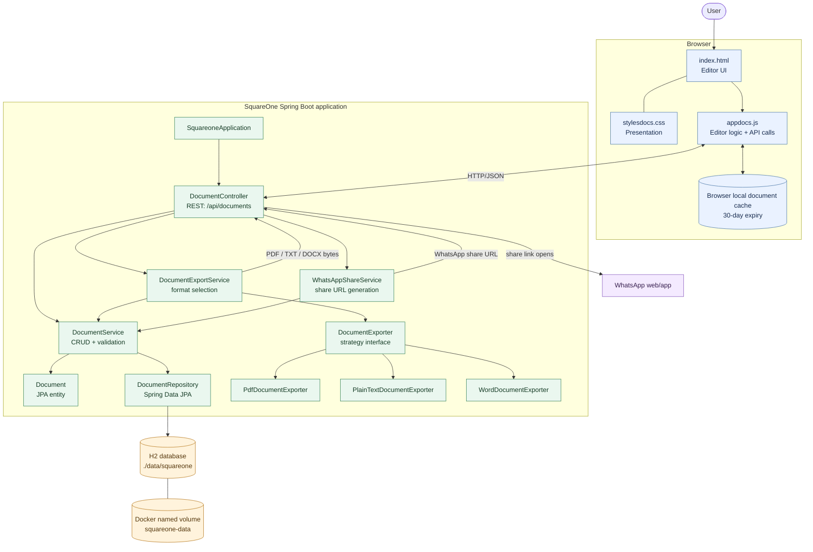
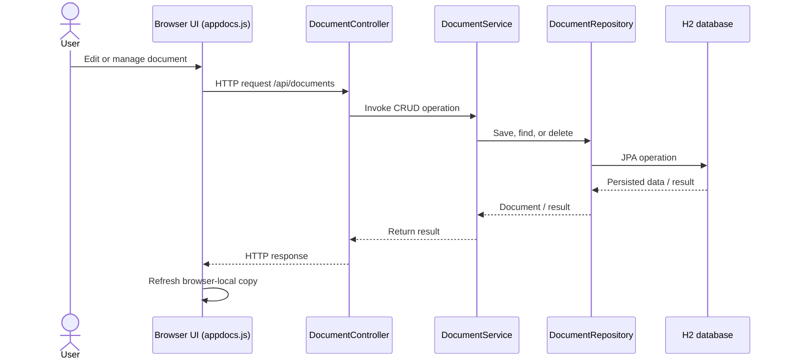
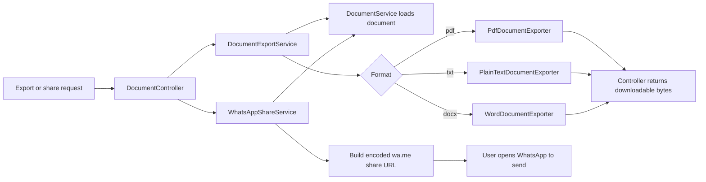

# SquareOne — Architecture Diagram

This diagram reflects the current `main` branch. It shows the browser UI, Spring Boot backend, persistence, export strategies, and sharing flow.

## System architecture

## Main request flows

### Create, read, update, and delete documents

### Export and WhatsApp sharing

## Responsibilities

| Component | Responsibility |
|---|---|
| `index.html`, `stylesdocs.css`, `appdocs.js` | Browser editor, styling, API calls, and local recovery cache |
| `DocumentController` | HTTP endpoints and response construction |
| `DocumentService` | Document CRUD operations |
| `DocumentRepository` | JPA persistence interface |
| `Document` | Document entity: ID, title, content, creation and update timestamps |
| `DocumentExportService` | Selects an exporter based on the requested format |
| `DocumentExporter` and implementations | Strategy pattern for PDF, plain text, and Word export |
| `WhatsAppShareService` | Creates a WhatsApp URL containing the document text |
| H2 | Primary persistent document store |
| Browser local cache | Temporary per-browser recovery copy; H2 remains the primary store |

## Important deployment note

The current application has no authentication or per-user document separation. Anyone who can reach the instance can access the shared document collection. The Docker Compose setup persists H2 data using the `squareone-data` named volume.

## View the diagrams

- **GitHub:** open this Markdown file; Mermaid diagrams render automatically.
- **VS Code:** open the file and press `Cmd+Shift+V` (macOS) or `Ctrl+Shift+V` (Windows/Linux). Use `Cmd+K V` / `Ctrl+K V` to preview beside the source.
