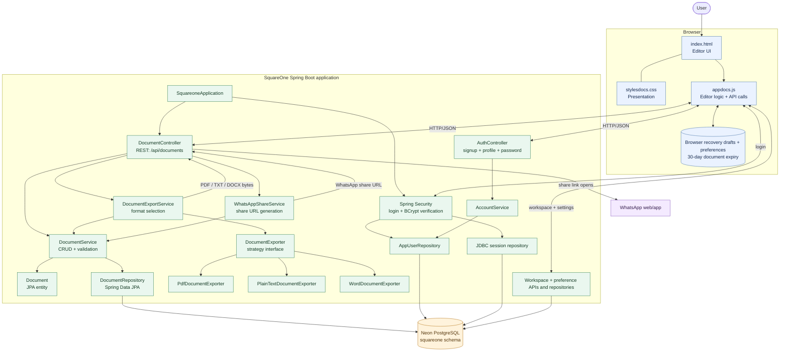
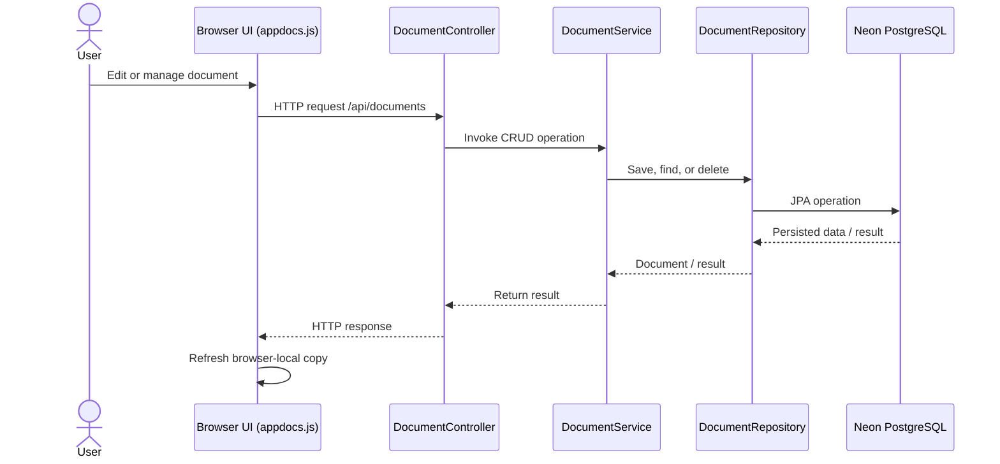
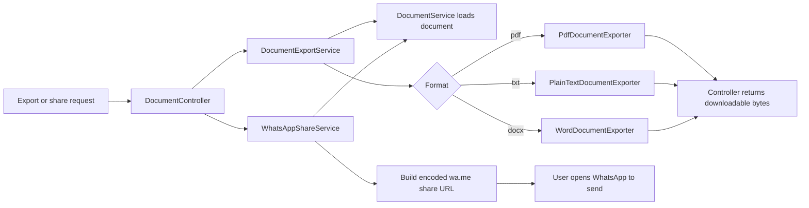

# SquareOne — Architecture Diagram

This diagram reflects the Neon-backed application. It shows the browser UI, Spring Boot backend, persistence, export strategies, and sharing flow.

## System architecture

## Main request flows

### Create, read, update, and delete documents

### Export and WhatsApp sharing

## Responsibilities

| Component | Responsibility |
|---|---|
| `index.html`, `stylesdocs.css`, `appdocs.js` | Browser editor, styling, API calls, and local recovery cache |
| `DocumentController` | HTTP endpoints and response construction |
| `DocumentService` | Document CRUD operations |
| `DocumentRepository` | JPA persistence interface |
| `Document` | Document entity: ID, title, content, creation and update timestamps |
| `DocumentExportService` | Selects an exporter based on the requested format |
| `DocumentExporter` and implementations | Strategy pattern for PDF, plain text, and Word export |
| `WhatsAppShareService` | Creates a WhatsApp URL containing the document text |
| `AppUserRepository` and Spring Security | Retrieve account records and verify BCrypt password hashes from Neon |
| Workspace and preference APIs | Persist account workspace and UI settings in Neon |
| JDBC session repository | Persist account and guest sessions in Neon |
| Neon PostgreSQL | Primary store for accounts, documents, metadata, history, workspaces, preferences and sessions |
| Browser local cache | Recovery drafts and pending changes; Neon remains the persistent server store |

## Important deployment note

Accounts and guest sessions have separate document/workspace ownership. Authentication loads the account and password hash from Neon; document, export and share APIs enforce ownership. Normal startup and Docker require the Neon database settings and do not create a local H2 database automatically. H2 is used only when explicitly configured for isolated checks. Deployment credentials stay in environment variables or the ignored `.env`, and HTTPS production uses Secure cookies.

## View the diagrams

- **GitHub:** open this Markdown file; Mermaid diagrams render automatically.
- **VS Code:** open the file and press `Cmd+Shift+V` (macOS) or `Ctrl+Shift+V` (Windows/Linux). Use `Cmd+K V` / `Ctrl+K V` to preview beside the source.
