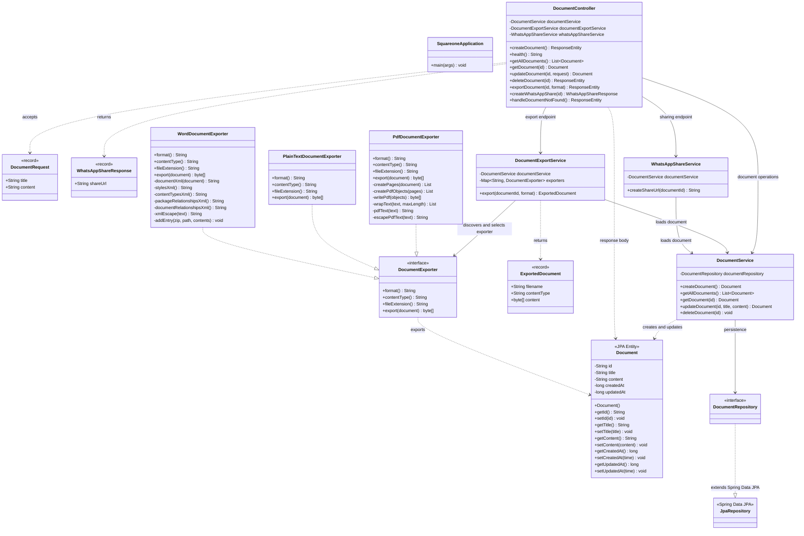

# SquareOne — Class Diagram

This diagram documents the current backend classes in `src/main/java/com/squareone`.

## Render the diagram

- **GitHub:** open this file; GitHub renders the Mermaid block automatically.
- **VS Code:** open this Markdown file, then press `Cmd+Shift+V` to preview or `Cmd+K V` to preview beside the source on macOS. On Windows/Linux, use `Ctrl+Shift+V` or `Ctrl+K V`.

## Main relationships

- `DocumentController` handles HTTP requests and delegates work to services.
- `DocumentService` performs CRUD operations through `DocumentRepository`.
- `Document` is the JPA entity persisted in the database.
- `DocumentExportService` selects an exporter by format (`pdf`, `txt`, or `docx`).
- The three exporter classes implement `DocumentExporter`, which is the Strategy pattern.
- `WhatsAppShareService` builds a WhatsApp share URL from the document title and content.

The diagram reflects the repository's current `main` branch. Update it when class responsibilities or relationships change.
